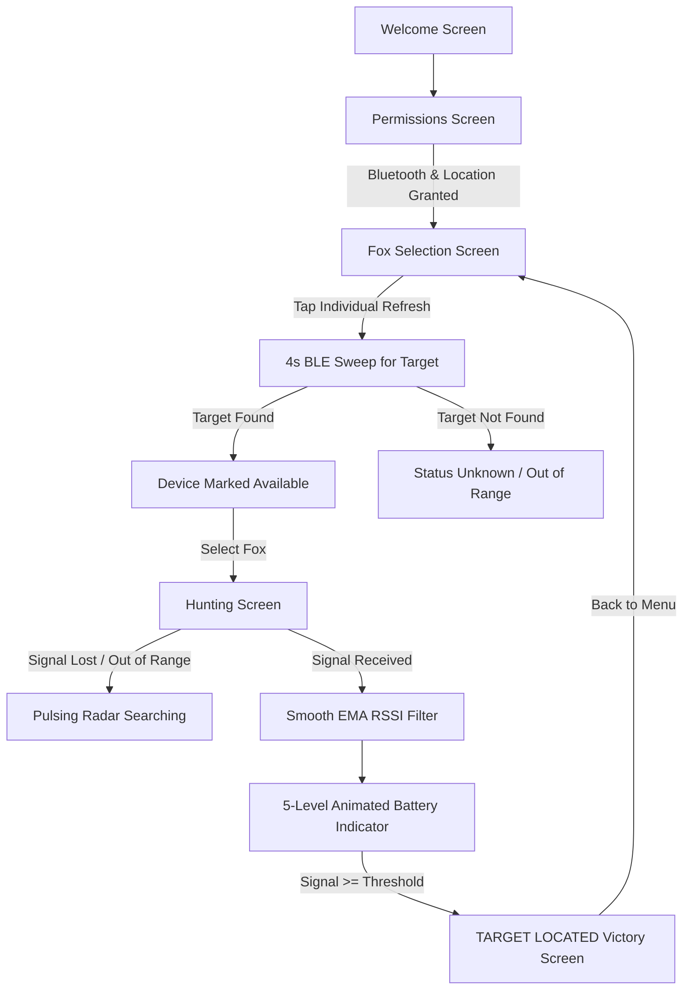

# 🦊 Foxhunt 2026

**Foxhunt 2026** is a cross-platform mobile application built with **Flutter** for playing amateur radio direction-finding games ("Fox Hunting"). Players use their smartphones to track down hidden radio beacon transmitters (Foxes) broadcasting Bluetooth Low Energy (BLE) signals.

---

## 📋 Table of Contents
- [Project Overview](#-project-overview)
- [How It Works](#-how-it-works)
- [Key Features](#-key-features)
- [Architecture & Tech Stack](#-architecture--tech-stack)
- [Why Bluetooth Low Energy (BLE) instead of Wi-Fi?](#-why-bluetooth-low-energy-ble-instead-of-wi-fi)
- [Hardware & Transmitters](#-hardware--transmitters)
  - [1. Flashing an ESP32 (Hardware Beacon)](#1-flashing-an-esp32-hardware-beacon)
  - [2. Using a Secondary Phone (Virtual Beacon)](#2-using-a-secondary-phone-virtual-beacon)
- [Target Configuration](#-target-configuration)
- [Project Structure](#-project-structure)
- [Getting Started & Installation](#-getting-started--installation)
- [Troubleshooting & Tips](#-troubleshooting--tips)

---

## 🎯 Project Overview

In traditional amateur radio fox hunting, participants use directional antennas and radio receivers to locate hidden transmitters. 

**Foxhunt 2026** digitizes this experience for modern mobile devices:
1. Hidden transmitters (ESP32 boards or mobile phones) broadcast BLE beacon signals named `FOXHUNT_01`, `FOXHUNT_02`, etc.
2. Players open the app, inspect target availability, and pick a Fox to hunt.
3. As the player moves closer to or farther from the hidden transmitter, the app measures the Received Signal Strength Indicator (RSSI), applies real-time smoothing, and displays a dynamic battery-style hot/cold indicator.
4. When the player gets within close proximity, the app triggers a "TARGET LOCATED" screen.

---

## 🔍 How It Works



---

## ✨ Key Features

- **Multi-Target Fox Selection:**
  - Displays four predefined targets: `FOXHUNT_01`, `FOXHUNT_02`, `FOXHUNT_03`, and `FOXHUNT_04`.
  - Individual per-device **Refresh** buttons to verify availability independently without interfering with other targets.
- **Continuous BLE Scanning & Cache Invalidation:**
  - Configured with `continuousUpdates: true` to prevent mobile operating systems from aggressively caching and ignoring duplicate beacon packets.
- **Battery-Style Signal Indicator:**
  - Horizontal battery gauge representing proximity.
  - Smooth animated transitions (`AnimatedContainer`) with neon glowing drop-shadows.
  - Color gradient progression:
    - 🔴 **Very Cold** (Level 1: Red Accent)
    - 🟠 **Cold** (Level 2: Orange Accent)
    - 🟡 **Warm** (Level 3: Yellow Accent)
    - 🟢 **Hot** (Level 4: Light Green Accent)
    - ❇️ **Very Hot / Target Range** (Level 5: Green Accent)
- **Signal Jitter Reduction (EMA Filtering):**
  - Uses an Exponential Moving Average algorithm ($\alpha = 0.3$) to filter raw RSSI noise and radio reflection spikes.
- **Lost Signal Recovery:**
  - If a player moves out of range, the hunting view switches to a dedicated "SEARCHING" radar screen until the signal re-engages.
- **100% Offline:**
  - No cellular network, Wi-Fi router, cloud connection, or user authentication required.

---

## 🏗 Architecture & Tech Stack

- **Framework:** [Flutter](https://flutter.dev) (Dart 3)
- **BLE Library:** `flutter_blue_plus`
- **Permissions:** `permission_handler`
- **Platform Support:** Android (API 21+) and iOS (iOS 13+)

### Core Domain Logic
- **`ScannerRepository`** (`lib/data/scanner_repository.dart`): Abstracts Bluetooth Low Energy scanning streams, adapters, and continuous update cycles.
- **`TargetMatcher`** (`lib/domain/target_matcher.dart`): Case-insensitive and whitespace-tolerant matching for target names (`FOXHUNT_01`, etc.).
- **`RssiProcessor`** (`lib/domain/rssi_processor.dart`): Implements Exponential Moving Average (EMA) smoothing for unstable radio signals.
- **`SignalStateEngine`** (`lib/domain/signal_state_engine.dart`): Maps filtered RSSI decibel values (`dBm`) into discrete hot/cold game states.

---

## 📡 Why Bluetooth Low Energy (BLE) instead of Wi-Fi?

The project initially explored Wi-Fi SSID scanning, but transitioned to Bluetooth Low Energy for critical technical reasons:

| Feature / Constraint | Wi-Fi Access Point Scanning | Bluetooth Low Energy (BLE) |
|---|---|---|
| **iOS Support** | ❌ **Blocked by Apple.** iOS strictly forbids non-system apps from scanning Wi-Fi networks (requires private entitlements). | ✅ **Fully Supported.** iOS natively supports core BLE scanning. |
| **Android Scan Throttling** | ⚠️ Severe. Android restricts foreground apps to 4 scans per 2 minutes. | ✅ **No throttling.** Real-time ~10Hz beacon packet delivery. |
| **Latency / Responsiveness** | Multi-second delays between network sweeps. | Sub-second updates for fluid, real-time hot/cold tracking. |
| **Target Hardware Power** | Wi-Fi AP consumes ~80–120 mA on ESP32. | BLE Beacon consumes fraction of power (~10–20 mA). |

---

## 🛠 Hardware & Transmitters

### 1. Flashing an ESP32 (Hardware Beacon)

An Arduino sketch is included in the root directory: [`esp32_ble_foxhunt.ino`](file:///home/krishna/Downloads/Fox_Hunt_2026/esp32_ble_foxhunt.ino).

```cpp
#include <BLEDevice.h>
#include <BLEUtils.h>
#include <BLEServer.h>

void setup() {
  Serial.begin(115200);
  BLEDevice::init("FOXHUNT_01"); // Name of the target

  BLEServer *pServer = BLEDevice::createServer();
  BLEAdvertising *pAdvertising = BLEDevice::getAdvertising();
  
  pAdvertising->addServiceUUID("12345678-1234-1234-1234-1234567890AB");
  pAdvertising->setScanResponse(true);
  pAdvertising->setMinPreferred(0x06);  
  pAdvertising->setMinPreferred(0x12);
  
  BLEDevice::startAdvertising();
}

void loop() {
  delay(2000);
}
```

#### Flashing Instructions:
1. Open the **Arduino IDE**.
2. Open [`esp32_ble_foxhunt.ino`](file:///home/krishna/Downloads/Fox_Hunt_2026/esp32_ble_foxhunt.ino).
3. Connect your ESP32 via USB cable.
4. Select your board under **Tools > Board** (e.g. *DOIT ESP32 DEVKIT V1* or *ESP32 Dev Module*).
5. Select the correct COM/Serial port under **Tools > Port**.
6. Click **Upload**.
7. *(To flash Fox 2, change `"FOXHUNT_01"` to `"FOXHUNT_02"` and upload to your second ESP32).*

---

### 2. Using a Secondary Phone (Virtual Beacon)

If you don't have multiple ESP32 boards, you can simulate additional foxes (`FOXHUNT_02`, `FOXHUNT_03`, etc.) directly from any Android phone:

> [!NOTE]
> Standard **Mobile Hotspot** is a **Wi-Fi** protocol and will **not** be seen by the BLE scanner. You must broadcast a Bluetooth beacon instead.

1. Install **nRF Connect for Mobile** or **BLE Beacon Simulator** from Google Play.
2. Open the app and navigate to the **Advertiser** tab.
3. Create a new advertisement packet:
   - Set **Device Name / Local Name** to `FOXHUNT_02` (or whichever fox you are simulating).
   - Set advertising interval to **100ms – 250ms**.
4. Tap **Start Advertising**.
5. The Foxhunt app will now detect this phone when you tap refresh on that target row.

---

## 🎯 Target Configuration

The target names are defined in `lib/main.dart`:

```dart
final List<String> _targetNames = [
  'FOXHUNT_01',
  'FOXHUNT_02',
  'FOXHUNT_03',
  'FOXHUNT_04'
];
```

You can add more targets or change names to match your event rules.

---

## 📂 Project Structure

```
Fox_Hunt_2026/
├── android/                   # Native Android configuration (Bluetooth & GPS permissions)
├── ios/                       # Native iOS configuration (Bluetooth usage description)
├── lib/
│   ├── data/
│   │   └── scanner_repository.dart    # BLE scan stream wrapper (flutter_blue_plus)
│   ├── domain/
│   │   ├── rssi_processor.dart        # Exponential Moving Average (EMA) smoothing
│   │   ├── signal_state_engine.dart   # RSSI decibel to Hot/Cold state mapper
│   │   └── target_matcher.dart        # Case-insensitive string matching
│   └── main.dart                      # UI Screens (Welcome, Permissions, Fox Selection, Hunting)
├── test/
│   └── domain_test.dart               # Unit tests for domain logic
├── esp32_ble_foxhunt.ino      # ESP32 Arduino firmware for BLE beacon
├── pubspec.yaml               # Dependencies (flutter_blue_plus, permission_handler)
└── README.md                  # Project documentation
```

---

## 🚀 Getting Started & Installation

### Prerequisites
- [Flutter SDK](https://flutter.dev/docs/get-started/install) (3.x or later)
- Android Studio / Android SDK (Platform SDK 34+)
- A physical Android device or iPhone (Emulators/Simulators do not have Bluetooth hardware)

### Setup & Run
1. Clone the repository and fetch dependencies:
   ```bash
   cd Fox_Hunt_2026
   flutter pub get
   ```
2. Connect your physical phone via USB with USB Debugging enabled.
3. Run the app:
   ```bash
   flutter run
   ```
4. During testing in the terminal:
   - Press **`r`** for **Hot Reload** (UI layout adjustments).
   - Press **`R`** for **Hot Restart** (State / variable shape changes).

---

## 💡 Troubleshooting & Tips

- **App says "Status Unknown" after refresh:**
  - Verify that your transmitter device is powered on.
  - Make sure the broadcast name strictly matches `FOXHUNT_01`, `FOXHUNT_02`, etc.
  - Verify that Location / GPS is turned ON globally in your phone's Android status shade (required by Android OS for BLE discovery).
- **Mobile hotspot isn't detected:**
  - Mobile hotspots are Wi-Fi networks. The app is a BLE scanner. Use a BLE advertiser app (like nRF Connect) instead of the Wi-Fi hotspot toggle.
- **Signal jumps wildly:**
  - Raw 2.4 GHz radio signals fluctuate due to physical obstructions and reflections. The built-in EMA filter smooths this out; move steadily for the most accurate direction estimates.
